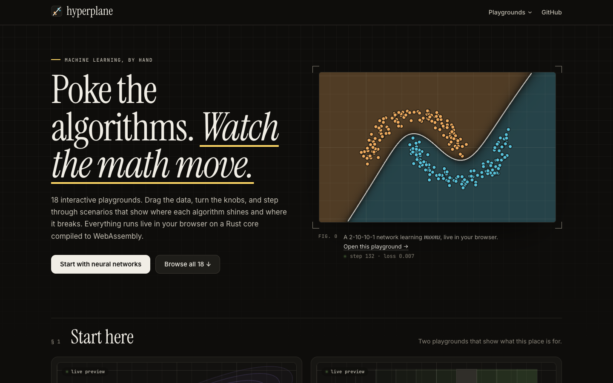
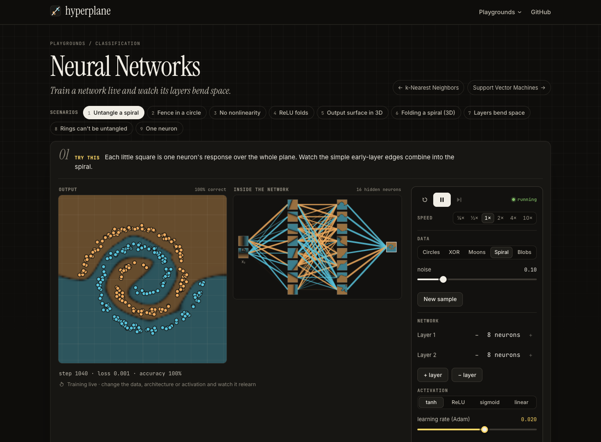
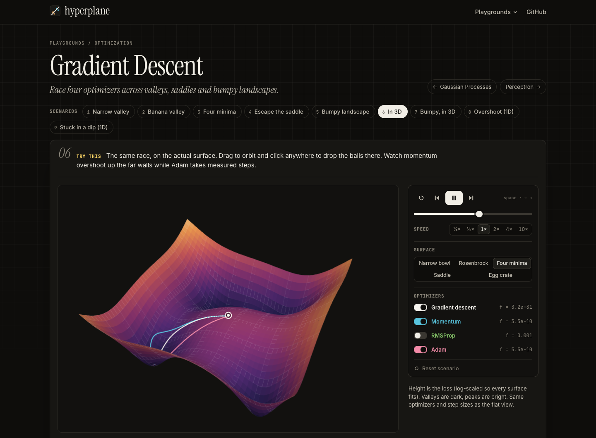
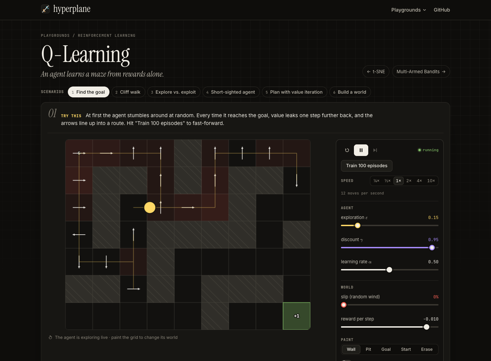

# Hyperplane

**Poke the algorithms. Watch the math move.**

Interactive playgrounds for machine learning. Drag the data, turn the knobs, and step through scenarios that show where each algorithm shines and where it breaks. Every algorithm runs live in your browser.

### → [hyperplane.jatinm.com](https://hyperplane.jatinm.com/)

[](https://hyperplane.jatinm.com/)

<table>
  <tr>
    <td width="33%"><a href="https://hyperplane.jatinm.com/play/neural-networks"></a></td>
    <td width="33%"><a href="https://hyperplane.jatinm.com/play/gradient-descent?s=3d"></a></td>
    <td width="33%"><a href="https://hyperplane.jatinm.com/play/q-learning"></a></td>
  </tr>
  <tr>
    <td align="center"><b>Neural networks</b><br>watch a network untangle a spiral</td>
    <td align="center"><b>Gradient descent</b><br>race optimizers over a 3D loss surface</td>
    <td align="center"><b>Q-learning</b><br>an agent learns a world you paint</td>
  </tr>
</table>

## What's inside

18 playgrounds and 111 scenarios:

- **Regression:** linear regression, overfitting & regularization, Gaussian processes
- **Optimization:** gradient descent (GD, momentum, RMSProp, Adam)
- **Classification:** perceptron, logistic regression, k-NN, naive Bayes, SVMs, decision trees & forests, neural networks
- **Clustering:** k-means, Gaussian mixtures (EM), DBSCAN
- **Dimensionality reduction:** PCA, t-SNE
- **Reinforcement learning:** multi-armed bandits, Q-learning

Each one opens on a scenario that plays itself. You can pause, step, scrub and change the speed, then change anything and watch it rerun. The [playground guide](docs/playgrounds.md) lists every scenario.

## How it works

Everything is client-side: the algorithms are written in Rust and compiled to WebAssembly, and the UI is a static React site drawing on plain `<canvas>`. There is no server and no tracking. See [architecture](docs/architecture.md).

## Run it locally

```sh
npm install --include=dev
npm run dev:all        # builds the wasm core, starts Vite, rebuilds on Rust changes
```

Needs Node 24, Rust with the `wasm32-unknown-unknown` target, and [wasm-pack](https://github.com/drager/wasm-pack).

## Add a playground

New algorithms are welcome. The [contributing guide](docs/contributing.md) walks through it: write the algorithm in Rust with tests, build an instrument from the shared layout and controls, write a few scenarios, and register it.

## Docs

- [Playground guide](docs/playgrounds.md): every playground and scenario at a glance
- [Architecture](docs/architecture.md): the Rust core, the JS/WASM boundary, and how the UI animates
- [Contributing](docs/contributing.md): local setup, adding a playground, and how changes ship
